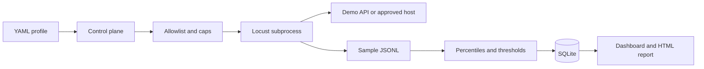

# PerfKit

PerfKit is a local API performance framework. You describe a target, endpoints, load shape, and thresholds in a YAML profile. PerfKit runs that profile through Locust against an allowlisted host, stores every sample, and reports measured throughput, response times, percentiles, and a pass/fail verdict.

The default target is a FastAPI demo in this repository. It uses synthetic users and balances. Profiles do not contain production hosts or credentials.

## What you can run

| Type | Shape |
| --- | --- |
| Load | Flat virtual-user count for the whole duration |
| Stress | Steps through 25, 50, 75, and 100 percent of the user cap |
| Spike | Low base, jump to the peak, return to the base |
| Soak | Flat moderate load. The bundled profile is 15 seconds so it stays safe to run locally |
| Baseline | Exactly one user |
| Concurrent | Flat higher concurrency and a short wait |
| Endpoint | Exactly one endpoint |

Bundled profiles live in `profiles/`. Each one carries its own thresholds. There is no global latency or error budget.

## Measured results

On 24 November 2026 these profiles were executed on this workstation against `http://127.0.0.1:8090`. The demo injected **0 ms** of artificial latency. Response times below are Locust measurements, not scripted numbers.

| Profile | Verdict | Requests | RPS | P95 ms | Error % |
| --- | --- | --- | --- | --- | --- |
| baseline | PASS | 25 | 3.10 | 7.51 | 0 |
| load | PASS | 384 | 38.24 | 7.74 | 0 |
| stress | PASS | 582 | 48.29 | 7.31 | 0 |
| spike | PASS | 570 | 63.01 | 7.07 | 0 |
| soak (15s) | PASS | 221 | 14.64 | 8.07 | 0 |
| concurrent | PASS | 2315 | 288.28 | 4.22 | 0 |
| endpoint-transactions | PASS | 306 | 37.97 | 7.77 | 0 |
| ci-smoke, run 1 | PASS | 185 | 22.97 | 8.25 | 0 |
| ci-smoke, run 2 | PASS | 181 | 22.42 | 8.03 | 0 |
| threshold-fail-demo | FAIL | 142 | 23.35 | 7.26 | 98.59 |

`threshold-fail-demo` calls `/demo/fault?status=500` while expecting HTTP 200. Of 142 samples, 140 were `http_5xx` and 2 were successful logins. P95 and throughput passed that profile's limits. The error-rate limit is 5 percent, so the verdict is FAIL.

The two `ci-smoke` runs are enough for a trend. P95 moved from 8.25 ms to 8.03 ms and throughput from 22.97 rps to 22.42 rps. Both deltas are inside the 5 percent stability band.

HTML reports copied from those executions are in [`docs/examples/`](docs/examples/). Full tables are in [`docs/examples/measured-results.md`](docs/examples/measured-results.md).

## Architecture



The control plane never passes profile text to a shell. Locust is started with an argument vector. Targets must be loopback, or a name in `PERF_ALLOWED_HOSTS` that resolves to a loopback or private address. Public hosts are rejected.

## Install

Python 3.11 or newer.

```bash
python -m venv .venv
source .venv/bin/activate
pip install -r requirements-dev.txt
export PYTHONPATH=src
export DEMO_API_USERNAME=demo
export DEMO_API_PASSWORD=demo-local-only
```

`demo-local-only` is a fixture password for the local demo. It is not a credential for any deployed system. Reports redact passwords and authorization headers.

## Run

Terminal 1:

```bash
python -m perfkit demo
```

Terminal 2:

```bash
python -m perfkit run --profile profiles/ci-smoke.yaml
python -m perfkit serve
```

Or start the demo automatically:

```bash
python -m perfkit run --profile profiles/load.yaml --start-demo
```

Open `http://127.0.0.1:8080` for the dashboard. It lists stored runs, KPIs, throughput, error rate, the response-time distribution, endpoint comparison, threshold checks, and trend direction once a profile has two completed runs.

## Docker

```bash
docker compose up --build
```

- Demo API: `http://127.0.0.1:8090`
- Dashboard and control plane: `http://127.0.0.1:8080`

Compose sets `PERF_TARGET_URL=http://demo-api:8090`. Loopback URLs in profiles are rewritten to that address after the allowlist check. Results persist in the `perfkit-data` volume. The dashboard container image is `docker/Dockerfile.dashboard`. Compose runs one control-plane service so SQLite has a single writer.

## Tests and CI

```bash
ruff check src tests
bandit -r src -q -c pyproject.toml
pip-audit -r requirements.txt
python -m perfkit scan
python -m pytest
```

GitHub Actions installs dependencies, lints, scans, audits, runs the full pytest suite (including one bounded Locust smoke), runs `profiles/ci-smoke.yaml` again, and uploads the HTML report. CI does not call external systems.

## Further reading

- [Architecture](docs/architecture.md)
- [Profile configuration](docs/configuration.md)
- [Locust execution](docs/locust.md)
- [Metric definitions](docs/metrics.md)
- [Thresholds](docs/thresholds.md)
- [Troubleshooting](docs/troubleshooting.md)
- [Upwork case study](docs/portfolio/upwork-description.md)

## License

MIT. See [LICENSE](LICENSE).
