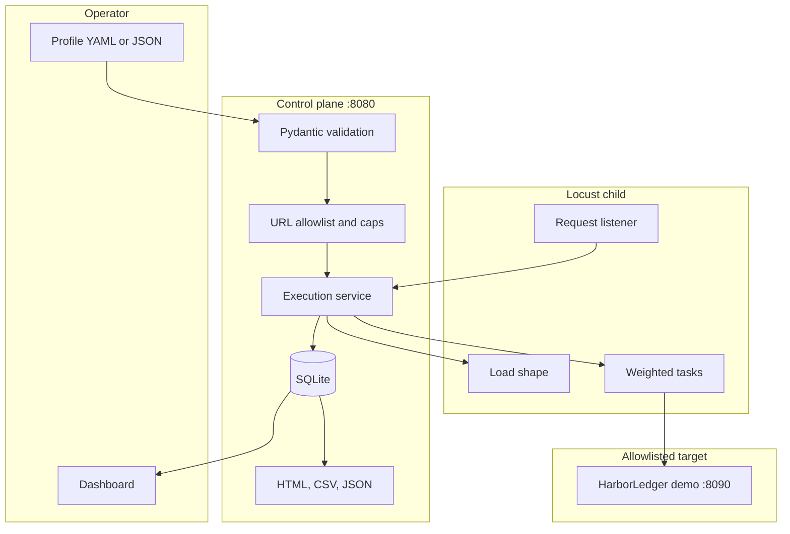

# Architecture

PerfKit is one Python package with four processes you can run separately.

## Boundaries

- **Demo API** (`perfkit.demo.app`). Synthetic users, accounts, transactions, search, pagination, validation, opt-in latency, and a fault endpoint. Authentication is an HMAC token minted for the local demo user.
- **Control plane** (`perfkit.api.app`). Profile listing, validation, one active run, history, charts, exports, and the dashboard.
- **Runner** (`perfkit.engine.runner`). Writes a redacted profile to disk, puts secrets only in the child environment, and starts `python -m locust` with a fixed argument list. `shell` is never enabled.
- **Metrics** (`perfkit.metrics`). Percentiles, endpoint comparison, one-second buckets, threshold checks, and trend slope. Pandas is used for CSV frames and a quantile cross-check. The numbers in the database come from the pure-Python implementation.
- **Storage** (`perfkit.storage`). Runs, aggregates, samples, categories, and threshold rows in SQLite.

## Controlled execution

A profile cannot:

- name a public host or a metadata address
- embed userinfo in the base URL
- exceed `PERF_MAX_USERS` or `PERF_MAX_DURATION_SECONDS`
- point at a file outside the profiles directory
- supply a shell command

Header values cannot contain newlines. Request paths must be relative. Locust calls are made with redirects disabled and a timeout of at most 30 seconds.

Only one run is active. Cancelling it terminates that Locust process.

## Load shapes

`perfkit.engine.plan` turns `test_type` into stages. Explicit `stages` in the profile replace the generated shape. The Locust `LoadTestShape` follows those stages and returns `None` when they are finished, which stops the test. `--run-time` is a safety cap set a little past the stage total.

## What is measured vs simulated

The demo sleeps only when a request sends `X-Demo-Latency-Ms`, and it caps that sleep at `DEMO_MAX_LATENCY_MS` (400). Bundled profiles do not send the header, so their samples are the real cost of the local process and client. The fault profile does generate HTTP 500s on purpose. Those failures are measured and categorized as `http_5xx`. They are not inserted into the database by hand.
